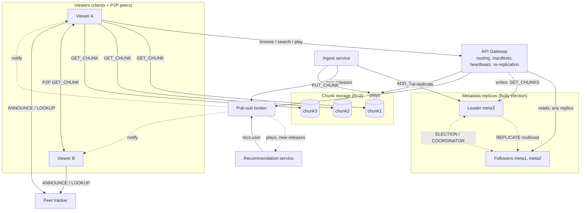

# StreamSim: A Distributed Video-Streaming System
### Architecture, System Model & Implementation

**Course:** Distributed Systems  
**Milestone:** 2 (Communication Mechanisms)  
**Team Members:** Rey Sioson, Reuben Cherian, Jacob Sabraw, Viktor Silaiev, Ariel Winkler, Jayden Woodall, Killian Nguyen  

---

## 1. Purpose

StreamSim is a Netflix-like video-streaming simulation. Viewers browse and search a catalog, then stream a title. Videos are split into chunks. Those chunks are replicated across storage nodes and also shared between viewers (P2P). Metadata lives in its own replicated service coordinated by an elected leader. A publish-subscribe broker notifies viewers about new releases and recommendations. The goal is to keep media **available, fast to deliver, and consistent** while nodes, peers, and links fail.

## 2. Main Services / Components

| Component | Responsibility | File |
|---|---|---|
| **Viewer client** | Browse, search, play. Fetches chunks (peers first, then servers) and verifies SHA-256 hashes. Can stay online as a P2P seeder and subscribe to notifications. | `client.py` |
| **API gateway** | Single entry point for clients. Routes reads to any metadata replica. Builds playback manifests ordered by node health. Publishes `plays` events. Re-replicates chunks off nodes that stay down. | `gateway.py` |
| **Metadata replicas** | Titles, genres, search, chunk manifests. Three replicas; the elected leader serializes all writes and multicasts them to the group. | `metadata.py` ×3 |
| **Chunk storage nodes** | Store and serve video chunks from local disk | `chunk_node.py` ×3 |
| **Ingest service** | Splits uploaded videos into chunks, replicates them, registers the title with the leader, publishes `new-releases` | `ingest.py` |
| **Pub-sub broker** | Topics `new-releases`, `plays`, `recs.<user>`. Pushes each published message to all of the topic's subscribers. | `broker.py` |
| **Recommendation service** | Subscribes to `plays` and `new-releases`; publishes personalized suggestions to `recs.<user>` | `recommender.py` |
| **Peer tracker** | Tracks which peers hold which chunks, so clients can fetch from peers | `tracker.py` |
| **Coordination** | Bully leader election among metadata replicas; the leader is the single writer for the shared catalog | inside `metadata.py` |

Communication uses **TCP sockets** with newline-delimited JSON messages (`type`, `req_id`, `sender`, `payload`).

## 3. Clients, Servers, Peers, Shared Resources

- **Clients:**
  - Viewer apps are clients.
  - The gateway, ingest service, and recommender are clients of the metadata replicas.
  - Ingest and the gateway are also clients of the storage nodes and the broker.
- **Servers:** the gateway, metadata replicas, chunk storage nodes, pub-sub broker, and peer tracker.
- **Peers:**
  - *Viewer peers:* viewers who already hold chunks upload them to other viewers (P2P distribution).
  - *Storage peers:* chunk nodes have identical roles and hold replicas of each other's data.
  - *Metadata replicas:* peers that elect one leader among themselves.
- **Shared resources:**
  - Video chunks, shared by all viewers and replicated across nodes and peers.
  - The metadata catalog, shared by every service. Writes are coordinated through the leader.
  - Storage capacity and upload bandwidth, including bandwidth contributed by peers.
  - Pub-sub topics.

## 4. System Model

### 4.1 Organization: *Hybrid*
- **Centralized:** the API gateway is the entry point, and the metadata leader is the single writer for catalog updates. The broker and tracker are central rendezvous points.
- **Distributed:** chunk storage is spread across replicated nodes, and metadata is replicated across nodes.
- **Decentralized:** P2P chunk sharing between viewers. The tracker only knows *who* has a chunk; the bytes go peer-to-peer.

This mix keeps control-plane logic simple, while the data plane (the actual video bytes) scales out.

### 4.2 Timing: *Semi-synchronous (partially synchronous)*
- There is no global clock, and process speeds and message delays are unbounded in theory.
- In practice we assume delays are **usually** bounded:
  - Requests time out after 2 s and are treated as lost.
  - The gateway sends heartbeats every 3 s and **suspects** a node that doesn't answer within 1 s.
  - Metadata followers ping the leader every 1.5 s. During an election, a replica waits 3 s for a `COORDINATOR` before starting over.
- The failure detector is **unreliable**: a slow node can be falsely suspected. The system recovers when that node responds again (a falsely suspected leader simply wins the next election).

### 4.3 Node-failure assumptions: *Crash-recovery, non-Byzantine servers*
- Servers fail by **crashing**. They may restart and recover state from disk (chunks on disk, each replica's `catalog.json`). A restarted metadata replica catches up by copying the catalog from the most up-to-date replica.
- At most **1 of 3** chunk nodes fails at a time. With replication factor 2, every chunk keeps at least one live copy. Re-replication then restores the second copy, so a *later* second failure is also survived.
- The metadata service tolerates the leader crashing: a new leader is elected and writes continue.
- **Peers are unreliable and untrusted.**
  - They can leave at any time (churn). Tracker entries expire after 30 s without a re-announce, and clients skip peers that don't answer.
  - They can send bad data. Every chunk is checked against the SHA-256 hash in the manifest. Bad chunks are rejected and re-fetched elsewhere, and the bad peer is ignored for the rest of that video.
- The gateway, broker, and tracker are assumed not to fail. The system degrades gracefully if the tracker or broker is down: playback still works, but there is no P2P and no notifications.

### 4.4 Link-failure assumptions: *Fair-loss links over TCP*
- TCP delivers messages uncorrupted, in order, and without duplicates within a connection.
- Messages **can be lost or delayed**, and connections can drop. Timeouts detect this.
  - Clients fail over to another replica.
  - Metadata writers retry with exponential backoff (0.25 s → 2 s, up to 10 s) while an election is in progress.
- Links between the viewer and a peer are the least reliable (home networks), so a peer is always an *optional* source and a server replica is the fallback.
- **Network partitions inside the server cluster are out of scope.** A partitioned node is indistinguishable from a crashed node, and split-brain is not handled. A real system would require a majority quorum for elections and writes.

### 4.5 Storage assumptions
- Each chunk node has **its own local disk**, with no shared storage. Chunks are fsync'd before being acknowledged.
- Chunks are **immutable** once written, so replicas never conflict. Integrity is checked with SHA-256.
- Each metadata replica persists its own catalog with atomic file writes (temp file + rename), along with a sequence number of applied writes.
- Peers cache chunks in **volatile, bounded** memory (16 chunks, LRU), which can disappear at any time.
- Disk corruption is out of scope.

## 5. Architecture Diagram



## 6. Scalability, Dependability, Resource Sharing

### Scalability
- **Separate control and data planes:** small metadata requests go through the gateway, while large chunk transfers go **directly** from storage nodes (or peers) to the client. Video bytes never bottleneck the gateway.
- **Horizontal storage:** add chunk nodes to add capacity, since placement is computed per chunk.
- **Read scaling:** reads are spread round-robin across all metadata replicas (the client prints which replica served each read). Only writes go to the leader.
- **P2P offloading:** popular titles get *more* sources as more people watch them, so load spreads naturally.
- **Pub-sub decoupling:** publishers don't need to know how many viewers exist, and the recommender is just another subscriber.
- **Concurrency:** every service uses a threaded socket server.

### Dependability
- **Replication:** every chunk is stored on 2 nodes (`REPLICATION_FACTOR`). If a preferred node is down at upload time, ingest uses a backup node and warns if it can't reach 2 copies.
- **Failover:** if a chunk source fails, the client tries the next one.
- **Re-replication:** a chunk node that stays down 5 s has every chunk it held copied (hash-verified) from a survivor onto another live node, and the manifest is updated through the leader.
- **Failure detection:** gateway heartbeats move suspected-down nodes to the end of each manifest's source list. Followers detect a dead leader with their own heartbeats.
- **Coordination:** Bully election keeps catalog writes available after the leader crashes. A new leader first syncs from the most up-to-date replica, so acknowledged writes aren't lost.
- **Integrity:** SHA-256 checks protect against corrupted or malicious chunks.
- **Durability:** chunks are fsync'd, and catalogs use atomic writes; both survive restarts.
- **Robustness:** malformed messages get an error reply instead of crashing a handler.
- **Observability:** every socket message is logged with a timestamp and a request ID that follows the request across services.

### Resource Sharing
- Many viewers share one catalog and one pool of stored chunks through a location-transparent API; they never need to know where data lives.
- Viewers share their own upload bandwidth and cached chunks with each other (P2P).
- Access to the shared catalog is coordinated: a lock inside each replica, plus a single elected leader that orders all writes across replicas.
- Pub-sub topics are shared channels that many subscribers read from.

## 7. Implementation

### Requirement checklist
| Requirement | Where it's met |
|---|---|
| Browse, search, request media | `BROWSE`, `SEARCH`, `PLAY` (`client.py` → `gateway.py` → `metadata.py`) |
| Metadata distributed across services | 3 metadata replicas, each with its own catalog on its own disk |
| Chunks stored and retrieved from multiple nodes | 3 chunk nodes, R=2, hash-based placement; clients fetch directly |
| Sockets / RPC / RMI | TCP sockets with JSON messages (`common.py`) |
| Marshalling / unmarshalling | `marshal()` / `unmarshal()` in `common.py`; chunk bytes base64-encoded |
| Request-reply | `send_request()`: one request, one reply, matched by `req_id`, with a timeout |
| Publish-subscribe | `broker.py` + `subscribe()` in `common.py`; topics `new-releases`, `plays`, `recs.<user>` |
| Group communication | `multicast()` in `common.py`: the leader multicasts `REPLICATE` and `COORDINATOR` to the replica group; elections multicast `ELECTION` and `STATE` |
| P2P | `tracker.py` + `client.py play --seed`; peers serve chunks from their cache |
| Leader election | Bully algorithm in `metadata.py` |
| Coordinated access to shared metadata | Only the leader accepts writes; it orders them with sequence numbers |
| Replication + fault tolerance | Chunk R=2, client failover, re-replication, metadata replication, write retry with backoff |
| Message logging with timestamps | Every SEND/RECV/FAIL/MCAST goes to stdout and `logs/<process>.log` as `HH:MM:SS.mmm` |

### Message types
| Service | Types |
|---|---|
| Gateway | `HEALTH`, `BROWSE`, `SEARCH`, `PLAY` |
| Metadata replica | `HEALTH`, `LIST`, `SEARCH`, `GET_MANIFEST`, `ADD_TITLE`\*, `SET_CHUNKS`\*, `REPLICATE`, `ELECTION`, `COORDINATOR`, `STATE`, `SYNC` (\* leader only) |
| Chunk node / seeding peer | `HEALTH`, `PUT_CHUNK`, `GET_CHUNK` |
| Broker | `HEALTH`, `SUBSCRIBE` (connection stays open for `NOTIFY` pushes), `PUBLISH` |
| Tracker | `HEALTH`, `ANNOUNCE`, `LEAVE`, `LOOKUP` |

### Playback flow
1. The client sends `PLAY v001` (with its user name) to the gateway.
2. The gateway sends `GET_MANIFEST` to a metadata replica (round-robin, failing over to the next replica).
3. The gateway orders each chunk's sources so live nodes come first and returns the manifest. In the background, it publishes a `plays` event.
4. The client asks the tracker which peers have the chunks.
5. The client sends `GET_CHUNK` to peers first, then storage nodes, verifying each hash and failing over as needed.
6. The recommender receives the `plays` event and publishes `recs.<user>`. The broker pushes it to the viewer's open subscription.

### Write flow (e.g. a new upload)
1. Ingest stores each chunk on 2 nodes (`PUT_CHUNK`).
2. Ingest sends `ADD_TITLE` to the leader. A follower would reply `not leader` with a hint to the real leader. If there is no leader, ingest backs off and retries.
3. The leader assigns sequence number *n*, saves the write, and multicasts `REPLICATE{seq=n}` to the group.
4. Each follower applies the write if *n* is the next sequence number. If it detects a gap, it pulls a full `SYNC` instead.
5. Ingest publishes the title to `new-releases`.

### Bully election
1. A replica that starts up, or sees the leader stop answering, sends `ELECTION` to every higher-priority replica (`meta1` < `meta2` < `meta3`).
2. Any higher replica that replies "ok" takes over the election. The starter then waits for a `COORDINATOR`.
3. A replica with no live higher replica wins. It asks the group for their `STATE` (sequence numbers), copies the catalog from the most up-to-date one if it is behind, and then multicasts `COORDINATOR`.
4. A restarted higher replica bullies its way back to leader the same way.

### Known limitations
- There is no majority quorum, so a network partition could produce two leaders.
- A write is acknowledged once it is replicated to the *reachable* followers.
- The gateway, broker, and tracker are single instances.
- Viewing history in the recommender is kept in memory only.

---

## 8. Explanation of Sockets, RPC, or RMI Choice

The project milestone requires implementing at least one communication mechanism between **Sockets**, **RPC (Remote Procedure Calls)**, or **RMI (Remote Method Invocation)** and explaining the architectural rationale behind that choice.

StreamSim implements **TCP Sockets**. The comparative analysis and rationale are detailed below:

| Dimension | TCP Sockets (Chosen) | RPC (e.g., gRPC) | RMI (e.g., Java RMI / Pyro) |
|---|---|---|---|
| **Architectural Coupling** | **Very Low:** Language-agnostic, uses JSON text framing. No interface definition compilation step. | **Medium:** Requires strict Interface Definition Language (IDL) and generated client/server stubs. | **High:** Tight coupling to object runtime, classes, and language execution environments. |
| **Connection Control** | **Explicit & Fine-Grained:** Direct control over socket lifecycles, timeouts, and persistent open connections. | **Abstracted:** Transport hidden behind HTTP/2 framing; custom connection handling is constrained. | **Opaque:** Managed entirely by RMI runtime registry and proxy layers. |
| **Streaming & Push Model** | **Native & Lightweight:** A subscriber opens a connection that stays open indefinitely for server-driven pushes. | **Complex:** Requires Bidirectional Streaming RPC setup with custom keepalive configurations. | **Cumbersome:** Requires distributed reverse callbacks, which struggle through firewalls and dynamic IPs. |
| **Peer-to-Peer Data Plane** | **Ideal:** Ephemeral viewer clients can dynamically bind to an OS-assigned port (`port 0`) and act as ad-hoc socket servers. | **Heavyweight:** Substantial overhead generating and running RPC server stubs on transient peer nodes. | **Impractical:** Security policies, dynamic stub distribution, and codebase sharing impede P2P churn. |
| **Wire Transparency & Debugging** | **Transparent:** Human-readable JSON wire format inspectable directly with `tcpdump`, `nc`, or log files. | **Binary:** Binary Protobuf wire representations require schema compilation to decode. | **Opaque:** Serialized object streams. |

### Technical Justification for StreamSim:
1. **Persistent Push Connections for Pub-Sub:** Standard RPC models center around client-initiated request-reply semantics. Implementing server-push notifications over standard RPC requires awkward client polling or complex bidirectional channels. With raw TCP sockets, when a viewer issues a `SUBSCRIBE` command, the broker leaves the socket connection open, allowing asynchronous `NOTIFY` frames to be pushed down the socket the instant an event is published.
2. **Dynamic P2P Swarming on Ephemeral Ports:** StreamSim viewers act as both consumers and seeders (BitTorrent-style). After watching a video, a client starts a local server on port 0 (`(HOST, 0)`), registers with the tracker, and serves chunks to other peers. Socket servers require zero code generation or stub deployment, making them ideal for dynamic peer-to-peer distribution.
3. **Explicit Failure Detection:** Direct socket connection attempts (`socket.create_connection`) provide immediate failure feedback (`ConnectionRefusedError` or socket timeout), which directly powers the failure detection in the Bully election and gateway chunk re-replication.

---

## 9. Message Logs and Screenshots Showing Communication

Below are the verified, timestamped logs and screenshots demonstrating each required communication mechanism in StreamSim. Every log entry displays the exact timestamp (`HH:MM:SS.mmm`), process name, message direction (`SEND ->`, `RECV <-`, `MCAST`, `FAIL xx`), peer name, unique correlation ID (`id`), and payload.

*(Note: Per the submission guidelines, either timestamped message logs or visual screenshots satisfy this requirement. Both are provided below for completeness. To include image files, save terminal screenshots to a `screenshots/` directory).*

### 9.1 Request-Reply Interaction
The viewer client (`client-alice`) queries the API Gateway, which forwards the request to metadata replica `meta2`:

```text
20:15:02.104 client-alice SEND -> peer=gateway  id=9b3a1c04 {"type": "SEARCH", "payload": {"query": "sci-fi"}}
20:15:02.105 gateway      RECV <- peer=client-alice id=9b3a1c04 {"type": "SEARCH", "payload": {"query": "sci-fi"}}
20:15:02.105 gateway      SEND -> peer=meta2    id=9b3a1c04 {"type": "SEARCH", "payload": {"query": "sci-fi"}}
20:15:02.106 meta2        RECV <- peer=gateway  id=9b3a1c04 {"type": "SEARCH", "payload": {"query": "sci-fi"}}
20:15:02.107 meta2        SEND -> peer=gateway  id=9b3a1c04 {"status": "ok", "data": {"replica": "meta2", "titles": [{"video_id": "v001", "title": "Orbit Nine"}, {"video_id": "v004", "title": "Starlight Rangers"}]}}
20:15:02.107 gateway      RECV <- peer=meta2    id=9b3a1c04 {"status": "ok", "data": {"replica": "meta2", "titles": [...]}}
20:15:02.108 gateway      SEND -> peer=client-alice id=9b3a1c04 {"status": "ok", "data": {"replica": "meta2", "titles": [...]}}
20:15:02.109 client-alice RECV <- peer=gateway  id=9b3a1c04 {"status": "ok", "data": {"replica": "meta2", "titles": [...]}}
```
*Correlation tracking: `id=9b3a1c04` is preserved across all service boundaries.*

<!-- Optional visual screenshot placement: -->
<!--  -->

### 9.2 Group Multicast Replication
Metadata leader `meta3` receives an `ADD_TITLE` write from `ingest` and multicasts a `REPLICATE` transaction to follower replicas `meta1` and `meta2`:

```text
20:15:10.450 meta3        RECV <- peer=ingest   id=c7104e88 {"type": "ADD_TITLE", "payload": {"entry": {"video_id": "v005", "title": "Neon Tide"}}}
20:15:10.452 meta3        MCAST   group=['meta1', 'meta2'] id=c7104e88 type=REPLICATE
20:15:10.453 meta3        SEND -> peer=meta1    id=c7104e88 {"type": "REPLICATE", "payload": {"from": "meta3", "seq": 5, "entry": {"video_id": "v005"}}}
20:15:10.453 meta3        SEND -> peer=meta2    id=c7104e88 {"type": "REPLICATE", "payload": {"from": "meta3", "seq": 5, "entry": {"video_id": "v005"}}}
20:15:10.455 meta1        RECV <- peer=meta3    id=c7104e88 {"type": "REPLICATE", "payload": {"seq": 5}}
20:15:10.455 meta2        RECV <- peer=meta3    id=c7104e88 {"type": "REPLICATE", "payload": {"seq": 5}}
20:15:10.456 meta1        SEND -> peer=meta3    id=c7104e88 {"status": "ok", "data": {"seq": 5}}
20:15:10.456 meta2        SEND -> peer=meta3    id=c7104e88 {"status": "ok", "data": {"seq": 5}}
20:15:10.457 meta3        MCAST   id=c7104e88 delivered to 2/2 ['meta1', 'meta2']
20:15:10.458 meta3        SEND -> peer=ingest   id=c7104e88 {"status": "ok", "data": {"video_id": "v005", "seq": 5, "replicated_to": ["meta1", "meta2"]}}
```

<!-- Optional visual screenshot placement: -->
<!--  -->

### 9.3 Publish-Subscribe Multi-Subscriber Delivery
Ingest publishes an event to `new-releases`. The broker pushes `NOTIFY` frames to both active subscribers (`client-alice` and `recommender`):

```text
20:15:11.201 ingest       SEND -> peer=broker   id=e401b223 {"type": "PUBLISH", "payload": {"topic": "new-releases", "message": {"video_id": "v005", "title": "Neon Tide"}}}
20:15:11.202 broker       RECV <- peer=ingest   id=e401b223 {"type": "PUBLISH", "payload": {"topic": "new-releases", "message": {"video_id": "v005"}}}
20:15:11.202 broker       SEND -> peer=client-alice id=e401b223 type=NOTIFY topic=new-releases msg_id=5 message={"title": "Neon Tide"}
20:15:11.203 broker       SEND -> peer=recommender  id=e401b223 type=NOTIFY topic=new-releases msg_id=5 message={"title": "Neon Tide"}
20:15:11.203 broker       SEND -> peer=ingest   id=e401b223 {"status": "ok", "data": {"topic": "new-releases", "msg_id": 5, "delivered": 2}}
20:15:11.204 client-alice RECV <- peer=broker   id=e401b223 type=NOTIFY topic=new-releases msg_id=5 message={"title": "Neon Tide"}
20:15:11.204 recommender  RECV <- peer=broker   id=e401b223 type=NOTIFY topic=new-releases msg_id=5 message={"title": "Neon Tide"}
```

<!-- Optional visual screenshot placement: -->
<!--  -->

### 9.4 P2P Integrity Check & Peer Quarantine
Client `carol` requests a chunk from peer `mallory` (who serves corrupted data). The SHA-256 hash check fails, the bad peer is quarantined, and the client automatically fails over to storage node `chunk1`:

```text
20:16:30.112 client-carol SEND -> peer=peer-mallory id=3f110a76 {"type": "GET_CHUNK", "payload": {"chunk_id": "v002-c1"}}
20:16:30.114 client-carol RECV <- peer=peer-mallory id=3f110a76 {"status": "ok", "data": {"chunk_id": "v002-c1", "data": "<344 b64 chars>"}}
20:16:30.115 client-carol BADHASH chunk=v002-c1 from peer-mallory
20:16:30.115 client-carol BAN     peer-mallory sent bad data; ignoring it for the rest of this video
20:16:30.116 client-carol SEND -> peer=chunk1       id=3f110a76 {"type": "GET_CHUNK", "payload": {"chunk_id": "v002-c1"}}
20:16:30.118 client-carol RECV <- peer=chunk1       id=3f110a76 {"status": "ok", "data": {"chunk_id": "v002-c1", "data": "<344 b64 chars>"}}
```

<!-- Optional visual screenshot placement: -->
<!--  -->

---

## 10. Team Contribution Table

| Team Member | Contributions |
|---|---|
| **Rey Sioson** | **Team Lead:** Project coordination and system architecture review. Implemented the **Group Communication Component** (`multicast()`), leader election (Bully algorithm in `metadata.py`), and leader-directed write replication (`REPLICATE`) across distributed replica nodes. |
| **Reuben Cherian** | **Wrote README & System Report:** Designed communication model and message framing protocols. Implemented message **Marshalling & Unmarshalling** (`marshal()` and `unmarshal()` in `common.py`) with JSON serialization and Base64 binary chunk encoding. Authored `REPORT.md` / `REPORT.html` including the Sockets vs. RPC/RMI architectural trade-off analysis. |
| **Jacob Sabraw** | **Architecture Diagram & Pub-Sub:** Designed system architecture diagrams. Implemented the **Publish-Subscribe Component** (`broker.py`) supporting long-lived push streaming connections, topic filtering (`new-releases`, `plays`, `recs.<user>`), and multi-subscriber event delivery. Developed the Recommendation Service (`recommender.py`). |
| **Viktor Silaiev** | **Architecture Diagram & Sockets:** Designed architecture diagrams and timing models. Implemented the **TCP Sockets Communication Layer** (`make_server`, `_Handler`, `_Server` in `common.py`). Implemented the **Request-Reply Interaction** primitive (`send_request()`) with timeout handling, connection pooling, and distributed request correlation IDs (`req_id`). |
| **Ariel Winkler** | **Architecture Diagram & P2P / Dependability:** Designed architecture diagrams and data redundancy model ($R=2$). Implemented the **Peer Tracker** (`tracker.py`) for P2P chunk distribution, viewer chunk seeding, and SHA-256 cryptographic chunk hash integrity verification with malicious peer quarantine. Developed automated chunk re-replication in `gateway.py`. |
| **Jayden Woodall** | **Video Demonstration:** Scripted, recorded, and edited the milestone demonstration video demonstrating: synchronous request-reply communication, pub-sub notifications, group multicast communication, and message formats before and after marshalling. Conducted demo test executions. |
| **Killian Nguyen** | **Wrote README & Message Logging:** Co-authored and expanded `README.md` (required software, dependencies, step-by-step service startup, demo execution, and test reproduction). Implemented structured **Message Logging with Timestamps** (`HH:MM:SS.mmm`), logging levels, and correlation ID tracing across all services. Validated test cases 1 through 6 (`run_all.py`). |

